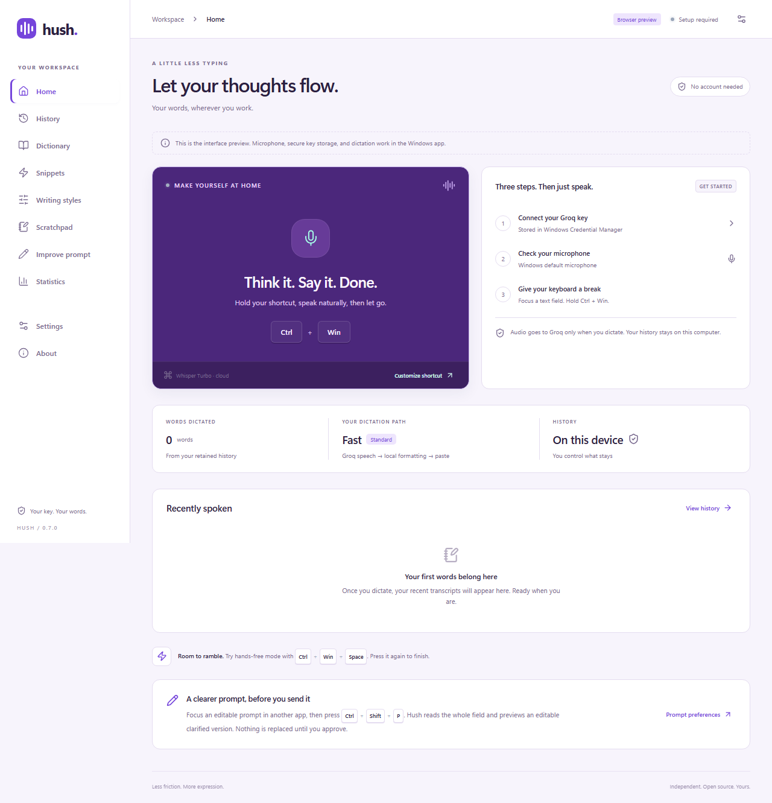

<p align="center"></p>
<h1 align="center">Hush</h1>
<p align="center">A little less typing. A lot more you.</p>
<p align="center"><a href="https://github.com/chahatesh/Hushline/actions/workflows/ci.yml"></a></p>

Hush is an independent, open-source Windows dictation application built with Rust, Tauri 2, and SolidJS. Hold a shortcut, say what you mean, and insert the result in the field where you were working. Choose Groq cloud recognition with your own API key, or download a local Whisper pack for offline dictation. Local automatic layout adds notes, bullets, and paragraphs without another AI call.

**Version 0.4.1 is a pre-release, with live acceptance pending.** The native pipeline and desktop interface have code and automated coverage; uninterrupted live speech → Groq → insertion still needs acceptance verification. The recording-ready sound, revised startup/release behavior, and whole-field prompt editing need live Windows checks before they can be treated as complete. Earlier 0.3.3 measurements and native checks remain historical evidence, not 0.4.1 performance guarantees. See the exact feature and test status in [FEATURES](docs/FEATURES.md), [QA](docs/QA.md), and the [performance report](docs/PERFORMANCE.md). A public release is blocked until core acceptance checks pass.

Hush was formerly named Hushline. The existing repository URL, application identifier, database name, credential slot, startup entry and executable name are retained for compatibility; saved keys and preferences stay in place.

Hush is not affiliated with, endorsed by, or an official product of Wispr Flow. All project branding and original code were created independently.



Native active voice bar (rendered on Windows):


## What is here

- Push-to-talk, hands-free recording, editable shortcuts, optional double-tap activation, Escape cancellation, tray lifecycle, and a nonactivating waveform overlay.
- A smooth-edged voice pill without a mic icon, with the timer on the left and × on the right; side docks put time above the waveform. A default 300 ms startup pause keeps it dark and still. A quiet, optional “bum” confirms the first microphone samples; only actual recording uses bright voice-reactive feedback. Preparing/transcribing/polishing/pasting stages stay dark. Default recordings allow ten minutes, with silence stopping optional.
- A five-second speech deadline (adjustable in Dictation settings). Timeouts cancel the request, show “audio was unable to process, please try again.” above the pill, and save the recording for Retry/Delete in Home. Retries return reviewable text and never paste into an old selection.
- Native WASAPI capture (CPAL enumerates devices), energy-based silence detection, bounded recording duration, in-memory 16 kHz mono WAV encoding, and asynchronous Groq speech requests. Brief microphone hiccups keep normal dictation working. Substantial audio loss holds the available speech for review.
- Optional offline Whisper Tiny/Base packs with verified downloads, local notes/bullets/paragraph layout, and optional editing through an installed local Ollama model. Tiny file transcription was tested; live offline delivery and Ollama editing remain unverified.
- Standard writing by default: Whisper transcription → conservative local cleanup → insertion. Choose Casual, Standard, or Formal independently of Always / Sometimes / Never AI polish. Formal needs AI for stronger rewriting; Never keeps all automatic editing local. Exact-word mode and snippets bypass automatic AI polish. Command Mode and Improve prompt are explicit actions.
- Windows protection/focus checks, default one-action clipboard paste with guarded restoration, optional compatibility Unicode typing, and last-transcript recovery. Pending original-field inspection survives recording release; opening Hush during processing retains recoverable text. Changed/unknown targets retain text for manual paste.
- Improve prompt with Ctrl + Win + P: read the whole explicitly focused editable field, Clarify or Expand it, then review and edit before approved replacement. No microphone or automatic prompt history. Unsupported fields remain unchanged.
- SQLite history, personal dictionary, exact-trigger multiline snippets with previews, writing styles by executable name, scratchpad, statistics, configuration backup, and in-memory stage timing diagnostics.
- Windows Credential Manager for the key, optional local history, no Hush account, no telemetry, no subscription, and no artificial application usage cap. **Groq's real charges and rate limits still apply.**

These are implemented code paths, not a blanket compatibility claim. Terminal automatic insertion, browser-domain styles, rich-text snippets, a signed updater, and several advanced formatting capabilities are not supported. See the feature matrix before relying on a specific workflow.

## Install

Source is available at [chahatesh/Hush](https://github.com/chahatesh/Hushline). No public GitHub Release is available yet; acceptance verification remains required. The installer uses a unique Windows registration and “Hush Dictation” shortcuts to avoid overwriting other apps named Hush. Earlier Hushline installations may be removed normally after testing Hush; keep app data when prompted. Locally built artifacts, when generated, are in:

- `src-tauri/target/release/bundle/nsis/Hush_0.4.1_x64-setup.exe` — per-user installer with shortcuts and uninstaller.
- `artifacts/Hush_0.4.1_x64_portable.zip` — executable plus license/readme. This uses the same Windows app-data settings; it is portable as a binary, not a fully isolated profile.

The installer is unsigned unless a maintainer signs it with their own certificate. It requires no administrator permissions for ordinary per-user use. WebView2 installation may be required. Ordinary updates retain app-data settings. Local history and the Groq key may remain after uninstall so an update/reinstall does not unexpectedly erase them; remove the key, clear history, and delete saved audio in the app before uninstalling if you want them deleted. Remove the remaining app-data directory yourself for complete removal. Startup is opt-in under Settings; no service is installed.

### Requirements

- Windows 10 or Windows 11, x64; interactive desktop session.
- Microsoft Edge WebView2 Runtime (the installer can download Microsoft's bootstrapper).
- A working microphone and Windows microphone privacy permission for desktop apps.
- For cloud mode: internet access to Groq and your own API key. For offline mode: a one-time 78 MB Tiny or 148 MB Base model download plus an 8 MB engine. No key or internet is needed for local transcription after installation. See [offline setup](docs/OFFLINE.md).
- The target application must run at an integrity level Windows permits Hush to interact with. Hush does not request elevation or bypass protected input boundaries.

## First dictation

1. Launch Hush and open **Settings → General**.
2. Create a key at [Groq Console](https://console.groq.com/keys), enter it in the password field, and choose **Save key**. Verify the key and refresh available models if desired.
3. Choose a microphone and save settings. Use **Test** to check capture; microphone tests send no audio to Groq.
4. Focus an editable field in Notepad. Hold **Ctrl + Win**, wait for the quiet ready sound and bright waveform, speak, then release. The initial pause defaults to 300 ms; a hold released during preparation is cancelled.
5. Stay in that field until processing ends. If focus changes, the text is preserved in Hush; copy it or focus your intended field and use the paste-last shortcut.

Fast microphone preparation is on by default and prepares a stopped native audio client without reading idle audio. **Dictation → Recording startup pause** adds an adjustable 0–1,500 ms pause, default 300 ms. The dark bar means “not recording yet”; the optional sound occurs once actual samples arrive, and the waveform then reacts to your voice. After the preparation pause, microphone startup has a five-second deadline instead of waiting indefinitely. Releasing an abandoned hold cannot start a later recording. Your existing double-tap preference is preserved; enabling double-tap adds its separate 350 ms release window.

Cloud recognition starts after you finish speaking. The speech deadline remains five seconds by default (adjustable 3–120), optional cleanup falls back after five seconds, and delivery has a two-second deadline. Slow requests preserve recoverable audio/text rather than producing a late paste. Measurements from previous builds and the small local-model tradeoff are documented in [PERFORMANCE](docs/PERFORMANCE.md) and [LOCAL_MODEL](docs/LOCAL_MODEL.md); neither instant inference nor negligible local-model RAM is promised.

The default speech model is `whisper-large-v3-turbo`. Choose `whisper-large-v3` for the accuracy option. Automatic language detection is the default; a selected language sends the supported `language` parameter. Verbose transcription metadata identifies the language without an extra inference call. English filler/formatting rules run only for confirmed English; other or unknown languages preserve recognized wording locally, with optional explicit AI processing. Dictionary hints use `prompt`; the app does not invent a streaming endpoint. Available text models are checked before AI editing, with `openai/gpt-oss-20b` and `openai/gpt-oss-120b` as configurable defaults. See [Groq speech documentation](https://console.groq.com/docs/speech-to-text), [API reference](https://console.groq.com/docs/api-reference), and [model list](https://console.groq.com/docs/models).

### Keyboard shortcuts

| Action | Default |
| --- | --- |
| Push-to-talk, hold/release | Ctrl + Win |
| Hands-free, toggle | Ctrl + Win + Space |
| Command Mode, hold/release | Ctrl + Win + Alt |
| Improve the whole focused prompt field | Ctrl + Win + P |
| Paste last transcript into current field | Ctrl + Win + V |
| Copy last transcript | Ctrl + Win + C |
| Open dashboard | Ctrl + Win + H |
| Open scratchpad | Ctrl + Win + J |
| Cancel active dictation/edit | Escape |

Shortcuts can use modifiers, one letter/number/F-key/Space, or Mouse4/Mouse5. Duplicate assignments within Hush are rejected. Other applications and Windows may intercept a shared shortcut; Hush cannot universally detect another process's low-level hook. Modifier-only chords need at least two modifiers.


### Offline, formatting, and the voice bar

Choose **Settings → Offline**, select Tiny or Base, and download the verified pack. Select **On this computer** under General and save. Offline mode does not require a Groq key and never falls back to a cloud provider. For optional advanced local rewriting, see [Ollama setup](docs/OFFLINE.md).

Choose a writing style under **Settings → Dictation**:

| Style | Result |
| --- | --- |
| Casual | Normal capitalization, no added periods or automatic paragraph/list layout. “I have four dogs” stays simple. |
| Standard | Appropriate sentence punctuation, readable paragraphs, and clearly detected lists. |
| Formal | Standard layout plus concise, professional grammar and wording when AI polish is enabled. |

Explicit spoken formatting such as “new paragraph” and “bullet point” works in all three styles. **Advanced transcription → Keep my exact words** instead preserves the recognition transcript and pauses styles, spoken commands, and automatic AI polish without changing the saved choices. Existing Clean/Polished profiles migrate to Standard/Formal; existing Literal profiles keep exact-word behavior with Casual selected underneath it. Provider, custom shortcuts, double-tap, AI frequency, keys, history, and timeout preferences stay in place.

**Automatic layout** detects clear notes and enumerations, can force notes or paragraphs, or leave layout unchanged. Casual bypasses automatic layout. “Meeting notes. First, review the draft. Second, send it to Maya.” can become a heading and two bullets. Multi-sentence items and mixed prose/list passages are handled conservatively; ordinary conjunctions do not create lists. English local rules are bounded patterns, not universal semantic understanding.

Clear self-corrections replace the explicitly retracted statement: **“I have three dogs. Wait, no, I actually have four.” → “I have four dogs.”** Casual omits the added terminal period. Ambiguous corrections preserve wording rather than guessing. AI receives mode-specific instructions to remove disfluencies, resolve clear corrections, get to the point, and preserve the intended facts. Validation uses the corrected meaning so retracted values may disappear while unrelated facts, names, numbers, URLs, and technical identifiers stay protected. Failed or rejected AI output falls back to locally cleaned text; these guards do not prove perfect semantic preservation.

Choose **Cloud AI polish** independently of the writing style:

- **Always** sends every ordinary dictation through the selected Groq text model.
- **Sometimes** uses deterministic length, enumeration, correction, or matching-style cues; no model is called to decide whether to call a model.
- **Never** performs local cleanup only, overriding automatic AI app styles.

Changing styles does not change that frequency. Exact-word mode and exact snippet expansions bypass automatic AI polish. Formal explains when stronger rewriting requires AI. Command Mode and Improve prompt remain explicit separate actions. Offline mode applies the same choices only through the configured local Ollama model and never sends text to Groq.
The **Voice bar** tab docks the native pill at the bottom, left, or right. It stays translucent and still at rest, expands only slightly, and becomes opaque during activation. Preparation and processing stay dark; the violet/turquoise waveform reacts only to captured audio. Errors appear above the pill ([native error-card capture](docs/screenshots/native-error-card.png)). Click it for hands-free mode, click × to cancel, or right-click to open the dashboard. It does not take keyboard focus. No animations run at rest. Errors and recovery warnings appear in a readable card above the bar; click the card to open Hush.

Shortcut releases no longer fall back into a shorter modifier-only chord. Hold-to-talk is stopped by release or the maximum duration, not the silence timeout. For Windows shortcut conflicts, choose **Shortcuts → Use dedicated-key shortcuts** or record your own combination with the keyboard button.

### Command Mode

Enable **Allow Command Mode to read selected text** in Settings first. Select text in the target app, hold the Command Mode shortcut, and say an editing instruction. Hush transcribes the instruction, sends only the selected text and instruction to Groq (or your configured local Ollama model in offline mode), and shows an edit preview. Approval may bring the original app forward, but replacement proceeds only if the field and selection still match. If access is unsupported or a selection changes, copy the edit instead. Hush never executes terminal commands, sends messages, or submits forms as a voice action.

### Improve prompt

Focus the prompt field in another app and press **Ctrl + Win + P**; this shortcut reads the **whole focused editable field**, not just selected words. It does not start the microphone. The initial action is shortcut-only so clicking the dashboard cannot accidentally target dashboard text. Set its shortcut in **Shortcuts** and choose its default action in **Dictation → Improve prompt**:

- **Clarify** makes the existing request clearer and better structured without adding requirements.
- **Expand** may propose additional requirements, placing every addition under **Suggestions (optional)** and assumptions under **Assumptions to confirm**.

Hush uses the configured Command Mode model, or only the configured local Ollama model in offline mode. The input is limited to 32,000 UTF-8 bytes (32 KB) and must be one supported editable field. Oversized input is rejected without truncation. Empty, protected, read-only, terminal, and unsupported fields are refused. The AI step has a cancellable 20-second deadline; proposed output is limited to 100,000 UTF-8 bytes (100 KB).

The original and an editable proposed result appear together. You can regenerate with Clarify/Expand, edit the proposal, **Apply**, **Copy**, or **Cancel**. Before Apply, Hush rechecks the original field identity and complete text, then replaces that field in one operation when supported. A changed or unavailable field retains the proposal for copying. No forms are submitted and no commands are executed. Prompt contents remain transient and are excluded from automatic history, configuration backups, and diagnostic exports. Real target-application acceptance is still pending; support is not universal.

### Dictionary, snippets, and styles

Add a dictionary word with a blank replacement for a vocabulary hint, or enter an exact whole-phrase replacement. Rules apply in one pass, without chained substitutions. Dictionary import/export uses JSON arrays of `{ "source": "groak", "replacement": "Groq" }` objects.

A snippet expands only when its trigger is the entire utterance. It supports multiline plain text, `{{date}}`, `{{time}}`, and optional confirmation. Rich text is not preserved. App styles match executable names such as `Code.exe` or `WINWORD.EXE` when context matching is enabled. Ordinary dictation performs no screenshot, browser-domain inspection, or surrounding-text collection. Only explicitly invoked Command Mode or Improve prompt reads its authorized selection or focused field.

## Privacy

The key is stored in Windows Credential Manager, not in SQLite, frontend assets, environment files, or logs. Your current Windows account is the trust boundary. Successful and cancelled recordings stay in memory and are released. Failed recordings are kept for retry: up to three clips for seven days, encrypted with Windows DPAPI inside SQLite. Private mode keeps failed clips in memory only until deletion or exit. Home offers Retry and Delete; a successful retry deletes its recovery audio. Configuration backups exclude recovery audio. Only recovery audio is encrypted; transcript history and settings are not. Audio already uploaded cannot be recalled by cancelling.

In cloud mode, audio is sent to Groq for dictation. In offline mode, it is piped to a local whisper.cpp process, with no cloud fallback. The local engine writes a temporary JSON transcript (no raw audio); it is deleted after processing. Offline models live under `%LOCALAPPDATA%\io.chahatesh.hushline\offline`. Text goes to Groq only for enabled AI processing, explicit Command Mode, or explicit Improve prompt; vocabulary hints also accompany speech requests. Groq's own data policies apply. Hush has no telemetry or cloud history store. Local data lives in `%APPDATA%\io.chahatesh.hushline\hushline.sqlite` (the Tauri user app-data directory); it is not database-encrypted. Disable local history for private mode and clear existing records separately. Configuration backups exclude API keys, history, recovery audio, scratchpad content, prompt previews, and diagnostics. Recent processing-stage timings/outcomes stay in memory, bounded to 200 events across up to 50 sessions; export them under **Privacy & data → Processing diagnostics**. They contain no transcript, prompt, audio, or API key.

Clipboard mode snapshots supported global-memory formats, refuses unsafe/oversized snapshots, and restores only if the clipboard sequence still matches. It leaves newer copied content alone. Some apps read clipboard contents asynchronously, so universal paste verification is not possible. Compatibility Unicode typing is opt-in and avoids clipboard changes; paste is the default. It preserves multiline output for copying instead of typing Enter, which could submit a message; choose clipboard insertion for multiline paste. Delivery is reported conservatively; check your text before sending it.

## Develop and build

Install [Tauri's Windows prerequisites](https://v2.tauri.app/start/prerequisites/): Node.js 22 LTS, Rust 1.90 or newer with the MSVC host (tested with 1.99.1), Microsoft C++ Build Tools and Windows SDK, and WebView2. Use a Visual Studio Developer PowerShell if the compiler is not discovered automatically. If PowerShell blocks `npm.ps1`, use `npm.cmd`; changing machine execution policy is unnecessary.

```powershell
npm ci
npm run desktop
```

Build and package:

```powershell
npm run build
npm run package
npm run portable
```

Run checks:

```powershell
npm run lint
npm test
npm run build
npx playwright install chromium
npm run test:ui
cargo fmt --manifest-path src-tauri/Cargo.toml --check
cargo clippy --locked --manifest-path src-tauri/Cargo.toml --all-targets -- -D warnings
cargo test --locked --manifest-path src-tauri/Cargo.toml
```

The ignored native test opens owned Windows edit controls and temporarily tests clipboard/input safety. Run it only on an interactive Windows desktop while you are not typing/copying:

```powershell
cargo test --manifest-path src-tauri/Cargo.toml native_input_clipboard_focus_and_password -- --ignored --test-threads=1 --nocapture
```

`npm run dev` alone opens a clearly labeled browser UI preview. It cannot record, store API keys, call Groq, or insert into Windows apps, and is not an end-to-end demo. Preview collection data lives separately in browser storage. The Playwright tests exercise interface behavior against compiled assets; they do not certify dictation.

No Groq key is needed to compile or run automated unit tests. Loopback HTTP fixtures test errors and documented request structure. See [architecture](ARCHITECTURE.md), [contribution guidance](CONTRIBUTING.md), and [publishing instructions](docs/PUBLISHING.md). The build badge links to the real repository. A latest-release badge is intentionally omitted while public release acceptance remains incomplete.

## Troubleshooting

| Symptom | What to check |
| --- | --- |
| No microphone or capture failure | Reconnect the device, refresh the list, check Windows microphone permissions, and save another input selection. |
| “audio was unable to process, please try again.” | Speech recognition exceeded the default five-second deadline. Open Home → Saved audio to retry. For long/offline recordings, increase Settings → Dictation → Transcription timeout (3–120 seconds). Optional AI cleanup has a separate five-second fallback; Command Mode editing has a ten-second deadline. |
| Substantial audio loss | Keep speaking. A measured gap of at least 250 ms, or 500 ms total, pauses snippets/automatic AI polish and holds the transcript for review/copy. Brief hiccups do not block paste. Lost audio cannot be reconstructed. |
| Nothing happens after a short hold | The default 300 ms startup pause must finish and actual samples must arrive before recording is ready. Wait for the ready sound/bright waveform, then speak. A hold released during preparation is cancelled. Check the error above the pill or Home for recoverable audio/text. |
| No speech detected | Test the microphone or lower the activity threshold slightly. This is energy detection; noise can also count as activity. |
| Improve prompt cannot read or replace a field | Use its shortcut while the complete editable prompt field is focused. Passwords, read-only fields, terminals, document-wide providers, unsupported controls, and inputs over 32 KB are refused. If the original changes before Apply, copy the proposal instead. |
| Key rejected | Replace the key in Settings and verify it with Groq model discovery. |
| Rate limit | Wait before retrying; check your Groq account's actual limits. Hush caps automatic retries and honors long retry delays by returning an error. |
| Text saved instead of inserted | Focus, caret, selection, or accessibility identity changed; the field is protected/read-only; or Windows blocked input. Recover the transcript manually. |
| Terminal dictation not inserted | Automatic terminal insertion is deliberately disabled. Copy and paste manually after reviewing the text. Integrated terminal behavior still needs compatibility testing. |
| Clipboard cannot be restored | Copy manually, or use compatibility typing for a single-line field. Hush refuses unsupported formats before changing them. |
| Command Mode cannot read a selection | Enable selected-text permission and use an app that exposes a supported UI Automation selection. |
| Dashboard closed but app remains running | This is the tray behavior. Use the tray menu's Quit action to exit. Reopening recreates the dashboard. Save scratchpad/settings drafts before closing. |
| A Windows shortcut is intercepted | Choose a different binding. Low-level shortcuts used by other software cannot all be enumerated. |

## Author and license

**Created by Chahatesh**

**License: MIT**

Copyright (c) 2026 Chahatesh. The original project code and assets are licensed under the complete [MIT License](LICENSE). Dependency code, Microsoft components, trademarks, and third-party assets retain their own licenses and ownership. See [SECURITY](SECURITY.md) for reporting and trust boundaries. Bundled dependency notices and full distributed license texts are in [THIRD_PARTY_NOTICES](THIRD_PARTY_NOTICES.md) and [THIRD_PARTY_LICENSES](THIRD_PARTY_LICENSES.txt).

